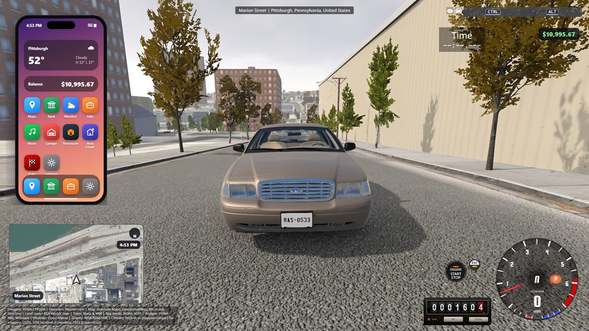
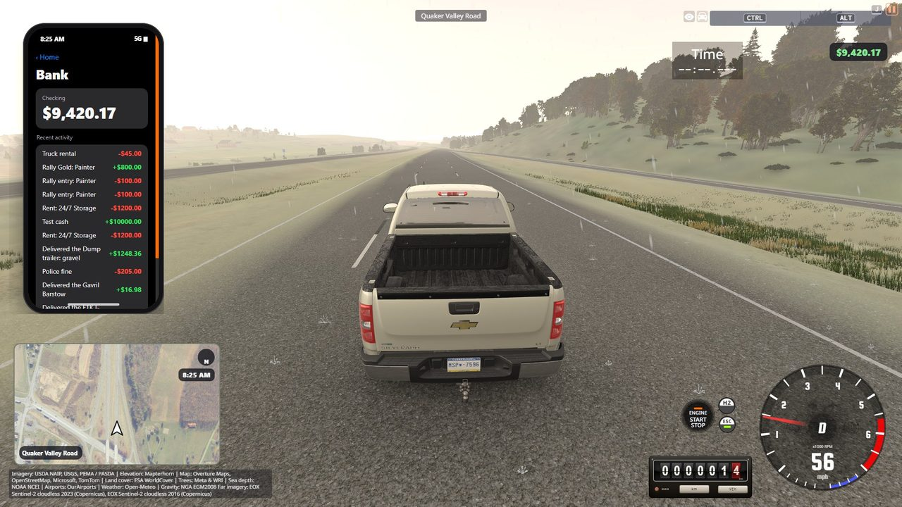
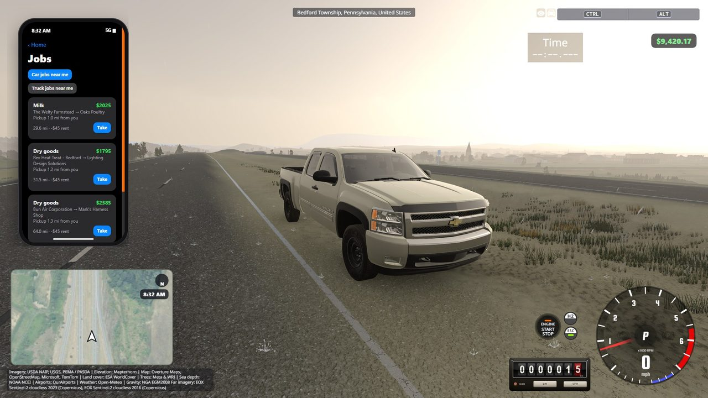
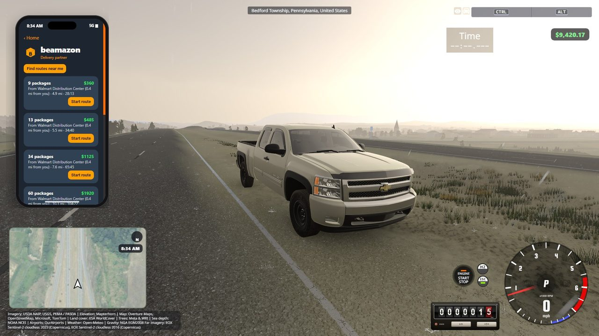
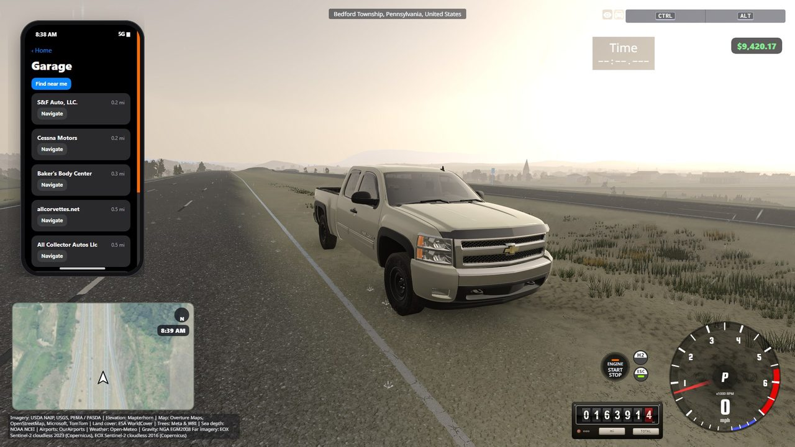
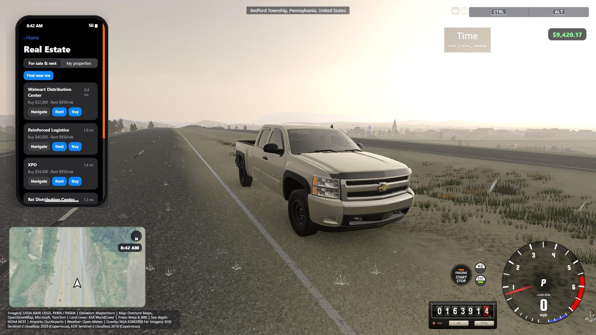
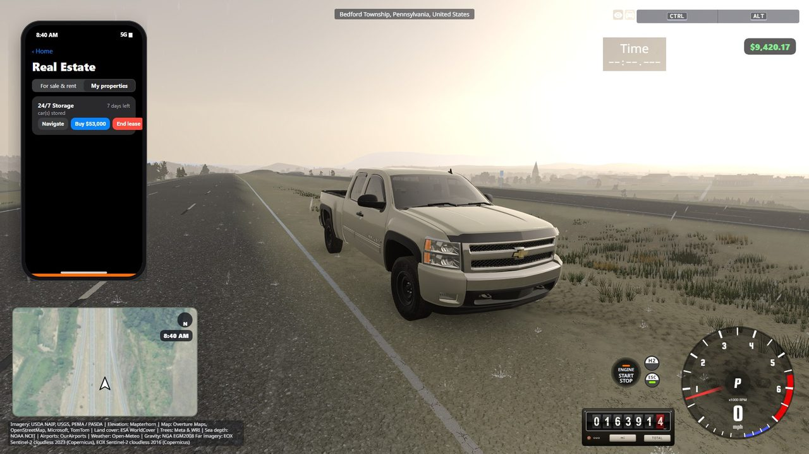
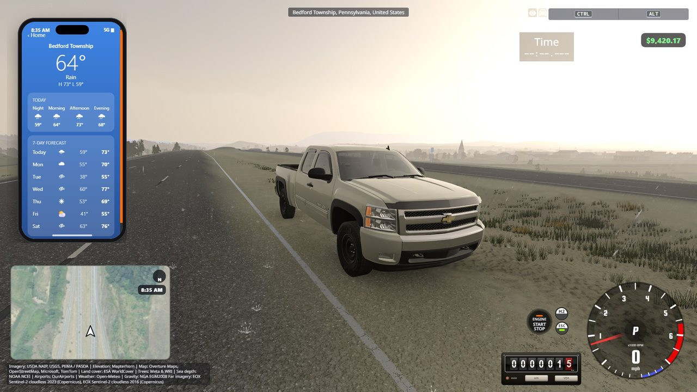

# BeamNG.Earth: gameplay features fork

**This is not the BeamNG.Earth mod itself.** BeamNG.Earth (the streamed 1:1 Earth, terrain, imagery, roads, buildings,
weather, multiplayer and everything else) is made by [TecnaGamer and its contributors](https://github.com/TecnaGamer/BeamNG.Earth).
For what the mod does, how it works, and how to install and play it, see
**[the original README](https://github.com/TecnaGamer/BeamNG.Earth#readme)**.

This fork only adds a **gameplay layer** on top of it. The list below is what we added, nothing more. Everything in
the mod that is not on this page is TecnaGamer's and its contributors'.

**Current version: 1.7.0-beta-features.2**, built on BeamNG.Earth 1.7.0 beta. Download it from
[Releases](https://github.com/justinkopriver-dotcom/BeamNG.Earth/releases).

| | |
|---|---|
| **Ours** | Phone, money, jobs, Beamazon, garage and real estate, rally, police heat, dynamic weather, guide signs, rumble strips, GPS turn-by-turn |
| **Not ours** | Everything else: terrain, imagery, roads, buildings, trees, multiplayer, the world map, Autodrive |
| **Not ours, included** | Guardrails: [PR #205](https://github.com/TecnaGamer/BeamNG.Earth/pull/205) by Arbuz |

### What's new in this release
- Built on **BeamNG.Earth 1.7.0 beta** (all of our features carried over)
- **Police are more forgiving:** a short burst of speed or one rolled stop no longer starts a chase
- **Truck jobs pay more** (about $5,000 for a two-hour run) and **lose pay more slowly** when the truck takes damage
- **Roads ahead of you load first** at speed, so road lines keep up
- **Lighter on the game:** less work per frame for tolls, road weather and rumble strips; the trailer appears a moment
  after a truck job starts

- **Branch:** [`my-features`](https://github.com/justinkopriver-dotcom/BeamNG.Earth/tree/my-features) has these
  features, built on BeamNG.Earth 1.7.0 beta. It also includes Arbuz's guardrail work from
  [PR #205](https://github.com/TecnaGamer/BeamNG.Earth/pull/205), which is theirs, not ours.
- **Offered upstream:** the same features, without #205, are on
  [`offer-features`](https://github.com/justinkopriver-dotcom/BeamNG.Earth/tree/offer-features) as a pull request
  to TecnaGamer's repository.

## What this fork adds

**Phone (Ctrl+O)**
- Bank, Weather (7-day forecast), Jobs, Beamazon, Rally, Garage, Real Estate, Music, Settings
- Music: play, pause and skip desktop Spotify, with a volume slider for Spotify only (the game's sound is untouched)
- Settings: wallpaper (your screenshots), theme, size, and a world-traffic switch (15 cars, 2 of them police)

**Money**
- A saved wallet: fuel at the gas stations and tolls cost money, and jobs, rally prizes and sales pay

**Jobs**
- Car deliveries between real garages, and truck freight between real depots in a rented semi with a loaded trailer
  matched to what each business ships
- "Near me" searches show how far each pickup is; pull into the green bay and press Start work. Your own car is
  parked as it is (fuel, damage) and handed back at the end
- Pay grows with distance (truck runs pay the most); damage costs pay slowly, with a free allowance; bonuses for no damage, a clean record and a delivery streak; tolls and fuel paid back

**Beamazon**
- Parcel van routes of 10, 20, 35 or 60 stops from real depots to residential streets, in their own app

**Garage & Real Estate**
- Real repair shops: repairs, parts billed at the part's value, plates, respray
- Property to buy, rent or sell, with car storage; a blue ring at each place opens its menu, with a workbench and
  laptop against the building's wall

  

**Rally**
- Real Susquehannock Trail Performance Rally stages near Wellsboro, PA (Asaph, Painter), built from the named
  forest roads
- Pacenotes made from the road's shape, called by the game's own co-driver voices (AK, RH, Dirtwheel), with a
  5-4-3-2-1 countdown and false start calls
- A loaned rally car (your car is parked and given back), the game's ground arrows along the stage, the stage on the
  GPS minimap, checkpoint splits, and a Reset to road button (+5 s)
- $100 entry (refunded if you quit before GO); gold, silver and bronze target times pay $800, $400 and $200

**Police heat**
- Forgiving police: a short burst of speed or one rolled stop is let go
- 1 to 5 stars; your plate and car are remembered; fines by stars, impound at 4 or more
- Pull over at once for a $30 to $150 ticket

**Weather**
- Dynamic weather: a weekly forecast for each ~50 km region, changing through the day; grip and a wet or snowy road
  look follow the rain and snow
- The phone shows when the weather is paused (set to manual by the menu or another mod) and turns it back on

**Roads, signs & GPS**
- US signs: speed limits, curve warnings, advisory plaques, chevrons, mileposts, county lines
- Green guide signs on motorways and trunk roads (exits, routes, mileage), toll gantries with CASHLESS TOLL signs
- Shoulder rumble strips beside the edge line, off crossing roads and bridges
- A satellite GPS minimap with turn-by-turn, distance, arrival time and the speed limit; a Gas button on the world
  map that takes you to the nearest gas station

**Other**
- A Pennsylvania-style license plate in the parts selector
- Calmer AI traffic and police driving
- `Play BeamNG.Earth.bat`: double-click to install once, then start the server and the game

## Install this fork
Install BeamNG.Earth as its [README](https://github.com/TecnaGamer/BeamNG.Earth#install-and-play) describes, but
from this fork's `my-features` branch (green **Code** button > **Download ZIP**, or build the package with
`python tools/package.py`). On Windows you can just double-click `Play BeamNG.Earth.bat`.

## Credits and license
BeamNG.Earth is by TecnaGamer and its contributors ([CREDITS.md](CREDITS.md)); this fork's additions are by Justin
Kopriver. Code: MIT, see [LICENSE](LICENSE). BeamNG.drive is a trademark of BeamNG GmbH; this is an unofficial fan
project and contains no BeamNG assets.
